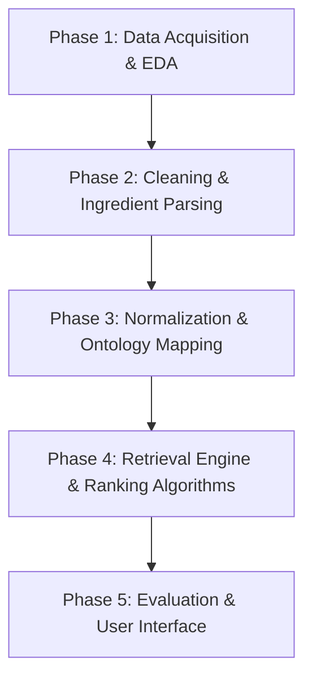

# SisaRasa: Sistem Temu Kembali Informasi Resep Masakan Berbasis Bahan Sisa

[](https://www.kaggle.com/code/elnathh/sisarasa)
[](https://github.com/Elnathz/sisarasa)
[](https://www.python.org/)
[](https://github.com/Elnathz/sisarasa)

---

## Identitas Pengembang

- **Nama**: Farros Rifantiarno Ramadhani
- **NIM**: A11.2024.15694
- **Program Studi**: S1 Teknik Informatika
- **Mata Kuliah**: Sistem Temu Kembali Informasi (STKI) - Semester 5
- **Tautan Kaggle**: [https://www.kaggle.com/code/elnathh/sisarasa](https://www.kaggle.com/code/elnathh/sisarasa)

---

## 1. Latar Belakang & Problem Formulation

*Food waste* di tingkat rumah tangga sering kali dipicu oleh ketidakmampuan mengolah bahan makanan sisa yang tersedia di kulkas atau dapur sebelum masa kedaluwarsa. Di sisi lain, pencarian resep konvensional biasanya berbasis nama masakan (contoh: "Ayam Goreng Lengkuas"), bukan berbasis bahan mentah yang secara faktual dimiliki pengguna.

**SisaRasa** dirancang sebagai sistem pencarian resep masakan berbasis pendekatan **Information Retrieval (IR)**:
- **Query ($Q$)**: Daftar bahan sisa yang diinputkan pengguna (misal: `["telur", "daun bawang", "nasi dingin"]`).
- **Dokumen ($D$)**: Koleksi resep masakan Indonesia (terdiri dari nama resep, daftar bahan, kuantitas, bumbu, dan instruksi langkah memasak).
- **Matching & Ranking**: Mengukur tingkat relevansi resep terhadap query bahan yang tersedia dengan mempertimbangkan *ingredient overlap*, *penalty for missing ingredients* (bahan tambahan yang harus dibeli), serta pembobotan bahan utama vs. bumbu pelengkap.

---

## 2. Dataset & Provenance

Dataset utama yang dieksplorasi bersumber dari:
- **Kaggle / Hugging Face**: [`junwatu/indonesian-recipes`](https://huggingface.co/datasets/junwatu/indonesian-recipes)
- **Format Data Mentah**: JSON / Parquet / CSV berisi korpus resep masakan Nusantara.

### Skema Data Target

| Atribut Target | Tipe Data | Deskripsi |
|---|---|---|
| `recipe_id` | String / Int | Identifier unik sintetis untuk tiap resep |
| `title` | String | Judul resep masakan |
| `ingredients_raw` | List / Text | Daftar bahan asli sebelum dinormalisasi |
| `ingredients_normalized` | List[String] | Bahan hasil tokenisasi, lematisasi, dan normalisasi sinonim |
| `ingredients_structured` | List[Dict] | Bahan terstruktur dengan kuantitas, satuan, dan penanda bumbu |
| `steps` | List[String] | Tahapan dan langkah pembuatan |
| `category` | String | Kategori hidangan (lauk, sup, tumis, sambal, dll.) |
| `difficulty` | String | Tingkat kesulitan memasak |
| `time_minutes` | Integer | Perkiraan durasi memasak dalam menit |
| `region` | String | Asal daerah kuliner |
| `source_url` | String | Tautan sumber resep asli |
| `duplicate_group_id` | String | Penanda kelompok duplikasi / near-duplicate |

---

## 3. Tahapan & Roadmap Pengembangan



### Phase 1: Data Acquisition & Exploratory Data Analysis (EDA) — *Status: Current*
- Implementasi loader multi-format (CSV, TSV, JSON, JSONL, Parquet, HF datasets) dengan mode read-only non-destruktif (`01_eda_dataset.ipynb`).
- Audit kualitas data (*data quality audit*):
  - Deteksi nilai null/kosong (`_eda_title_empty`, `_eda_ing_empty`, `_eda_steps_empty`).
  - Analisis parsing pola format bahan (`list_object`, `stringified_list`, delimiter `\n`, `;`, `|`, hingga unparsed `single_string`).
  - Deteksi duplikasi eksak dan identifikasi kelompok *near-duplicate* (judul mirip dengan kombinasi bahan identik vs. berbeda).
  - Distribusi statistik jumlah bahan dan langkah memasak per dokumen.
  - Analisis frekuensi bahan kasar (*rough ingredient frequency*) dan deteksi ekor panjang (*long-tail distribution*) akibat variasi ejaan.
- Ekspor artefak audit ke format tabular & JSON (`provenance.json`, `data_quality.csv`, `eda_report.json`).

### Phase 2: Preprocessing & Parsing Spesifik Bahan *(Next)*
- Rule-based regex & heuristic extractor untuk memisahkan kuantitas, satuan (`sdm`, `sdt`, `siung`, `gram`, `butir`), bahan utama, dan catatan pengolahan.
- Penanganan entri yang masih berbentuk teks naratif (*unparsed strings*).

### Phase 3: Normalisasi Bahan & Pembangunan Kamus Sinonim *(Planned)*
- Standardisasi variasi ejaan bahasa sehari-hari (contoh: `telor` $\rightarrow$ `telur`, `baput` $\rightarrow$ `bawang putih`, `cabe` $\rightarrow$ `cabai`).
- Klasifikasi bahan inti (*core ingredients*) vs bumbu dasar / pelengkap (*seasoning/pantry staples* seperti garam, gula, air, minyak).

### Phase 4: Model Retrieval & Algoritma Ranking *(Planned)*
- Eksplorasi model temu kembali:
  1. **Exact & Overlap Matching**: Jaccard Similarity, Dice Coefficient, Containment Metric.
  2. **Lexical Retrieval**: TF-IDF (Term Frequency - Inverse Document Frequency) dan Okapi BM25.
  3. **Custom Penalty-based Scorer**:
     $$\text{Score}(Q, D) = \alpha \cdot \text{Recall}(Q, D) + \beta \cdot \text{Precision}(Q, D) - \gamma \cdot \text{MissingPenalties}(D \setminus Q)$$
  4. **Dense / Hybrid Retrieval** *(Opsional)*: Embedding semantik menggunakan model representasi bahasa Indonesia (IndoBERT/Sentence-Transformers).

### Phase 5: Evaluasi Sistem & Antarmuka *(Planned)*
- Pengujian performa IR: Mean Average Precision (MAP), Mean Reciprocal Rank (MRR), Precision@K, Recall@K, dan Normalized Discounted Cumulative Gain (NDCG@K).
- Pembuatan antarmuka pengguna berbasis prinsip *Mobile-First*.

---

## 4. Struktur Repositori

```text
sisarasa/
├── .git/
├── 01_eda_dataset.ipynb       # Notebook eksplorasi data, audit kualitas, & pemetaan skema
└── README.md                  # Dokumentasi proyek & laporan arsitektur sistem
```

---

## 5. Cara Menjalankan Notebook

### Opsi A: Melalui Kaggle (Direkomendasikan)
1. Buka notebook di Kaggle: [https://www.kaggle.com/code/elnathh/sisarasa](https://www.kaggle.com/code/elnathh/sisarasa).
2. Tambahkan input dataset yang sesuai jika menggunakan mode lokal Kaggle, atau konfigurasikan `HF_TOKEN` pada menu **Add-ons > Secrets** bila menarik langsung dari Hugging Face.
3. Jalankan seluruh sel secara sekuensial (**Run All**).

### Opsi B: Melalui Lingkungan Lokal (Python / Jupyter Lab)
1. Clone repositori ini:
   ```bash
   git clone https://github.com/Elnathz/sisarasa.git
   cd sisarasa
   ```

2. Buat dan aktifkan virtual environment:
   ```bash
   python -m venv venv
   # Di Windows:
   venv\Scripts\activate
   # Di Linux/macOS:
   source venv/bin/activate
   ```

3. Instal dependensi dasar:
   ```bash
   pip install pandas numpy matplotlib datasets psutil jupyterlab
   ```

4. Jalankan Jupyter Lab / Notebook:
   ```bash
   jupyter lab 01_eda_dataset.ipynb
   ```

---

## 6. Catatan Kritis & Rencana Perbaikan (Engineering Notes)

1. **Kelengkapan Analisis Notebook**: Sel nomor 12 (Lisensi) dan sel nomor 13 (Kesimpulan Kuantitatif Phase 1) pada `01_eda_dataset.ipynb` perlu dilengkapi dengan data hasil eksekusi aktual agar status EDA tervalidasi secara empiris.
2. **Aksesibilitas Kaggle**: Pastikan pengaturan visibilitas notebook Kaggle berada pada status **Public** jika ditujukan untuk evaluasi akademik atau peer-review.
3. **Pemisahan Kamus Bumbu**: Tantangan terbesar pada perankingan resep adalah bias bumbu dasar (hampir semua masakan membutuhkan garam, bawang merah, dan bawang putih). Pembangunan stop-ingredients/staple-pantry checklist menjadi prioritas sebelum masuk ke kalkulasi BM25.
